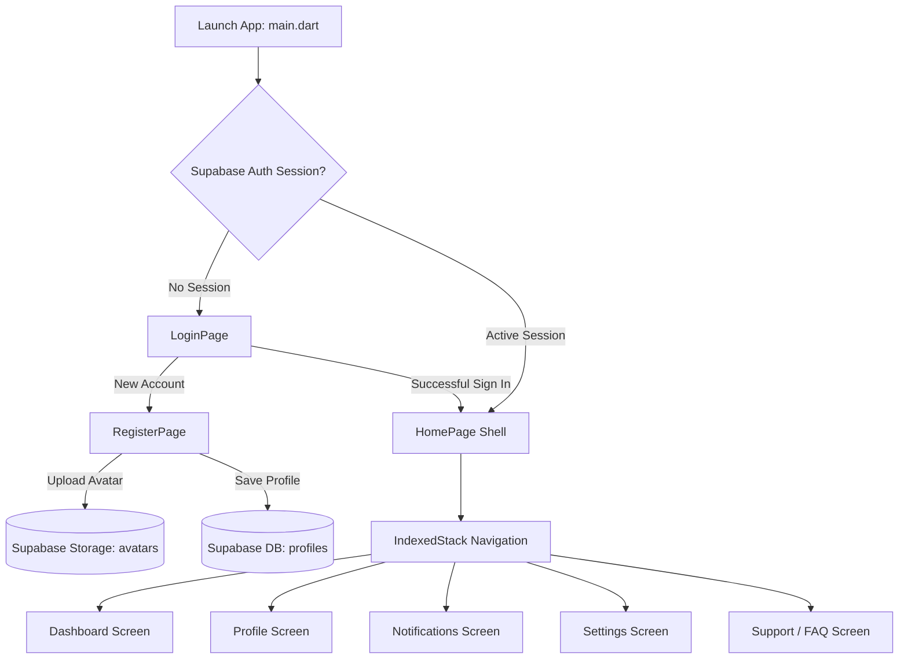

# 🚀 Flutter Supabase Modern Dashboard & Mobile Suite

[](https://flutter.dev)
[](https://dart.dev)
[](https://supabase.com)
[](https://flutter.dev)
[](LICENSE)
[](https://developer.apple.com/design/human-interface-guidelines)

A high-performance, responsive, cross-platform Flutter application powered by **Supabase Backend-as-a-Service (BaaS)**. Designed with an ultra-clean **iOS OLED Dark Mode** aesthetic, featuring real-time authentication, cloud profile storage with image uploads, persistent stateful navigation via `IndexedStack`, interactive analytics dashboards, in-app notification center, searchable settings, and an expandable knowledge base.

---

## 📱 Highlights & Features

- 🔐 **Supabase Authentication**:
  - Secure email & password Sign In and Sign Up flows.
  - Automatic session state persistence with reactive `StreamBuilder<AuthState>`.
  - Secure sign-out with user confirmation dialogs.
- 🖼️ **Storage & Media Handling**:
  - Native gallery image selection via `image_picker`.
  - Binary avatar upload directly to Supabase Storage (`avatars` bucket).
  - Dynamic profile generation linking auth identity with the `profiles` table.
- 🎨 **Apple iOS OLED Dark Theme**:
  - Pure black background (`#000000`) tailored for OLED displays and battery efficiency.
  - Cupertino-inspired cards, dividers, badges, elevated blur treatments, and system accent colors (`#0A84FF` Blue, `#30D158` Green, `#FF453A` Red).
- 🧭 **Seamless Persistent Multi-Tab Navigation**:
  - Fluid **Bottom Navigation Bar** and rich **Custom Navigation Drawer** synchronized via `IndexedStack` (zero-reload screen retention).
- 📊 **Comprehensive Modular Screen Architecture**:
  - **Dashboard**: Real-time KPI statistics cards, interactive activity graphs, quick action shortcuts, recent operational logs, and team members showcase.
  - **Profile Management**: Profile image viewer, customizable contact details (name, phone, role), and editable fields.
  - **Notification Center**: Categorized tabs (*All*, *Unread*, *System*), unread status indicators, and notification management.
  - **Settings & Preferences**: Live search filter, toggles for dark mode, push alerts, biometrics, offline sync, and real-time cache cleanup simulation.
  - **Help & Support**: Categorized FAQ with interactive accordion expansion tiles and search filtering.

---

## 🏗️ Architecture & Project Structure

```
lab4/
├── android/                        # Native Android configuration
├── ios/                            # Native iOS configuration
├── web/                            # Flutter Web runner
├── windows/                        # Windows desktop runner
├── lib/
│   ├── main.dart                   # Application entrypoint & Supabase auth listener
│   ├── login_page.dart             # Authentication login screen
│   ├── register_page.dart          # Sign up screen with image picker & storage upload
│   ├── home_page.dart              # Shell scaffold, custom drawer & bottom navigation
│   └── screens/
│       ├── dashboard_screen.dart   # KPI metrics, activity chart & overview
│       ├── profile_screen.dart     # User profile details & editing
│       ├── notifications_screen.dart # Notification feed with tab filtering
│       ├── settings_screen.dart    # App preferences, toggles & cache control
│       └── support_screen.dart     # Searchable FAQ & assistance hub
├── pubspec.yaml                    # Dependencies and project metadata
└── README.md                       # Repository documentation
```

### Flow Diagram



---

## 🛠️ Tech Stack & Packages

| Component | Technology | Description |
| :--- | :--- | :--- |
| **Framework** | [Flutter](https://flutter.dev) | Google's UI toolkit for multi-platform compilation |
| **Language** | [Dart](https://dart.dev) | Strongly-typed, object-oriented language |
| **Backend & Auth** | [supabase_flutter](https://pub.dev/packages/supabase_flutter) | Supabase client for Authentication, Database, & Storage |
| **Media Picker** | [image_picker](https://pub.dev/packages/image_picker) | Multi-platform image selection from camera/gallery |
| **Icons & Design** | `cupertino_icons` / Material 3 | Apple-style icons combined with modern Material tokens |

---

## ⚡ Getting Started

### Prerequisites

Ensure you have installed:
- [Flutter SDK](https://docs.flutter.dev/get-started/install) (`^3.13.0` or higher)
- [Dart SDK](https://dart.dev/get-dart) (`^3.0.0` or higher)
- Android Studio / Xcode / VS Code with Flutter extensions
- A [Supabase](https://supabase.com) account and project

### 1. Clone the Repository

```bash
git clone https://github.com/your-username/flutter-supabase-dashboard.git
cd flutter-supabase-dashboard
```

### 2. Install Dependencies

```bash
flutter pub get
```

### 3. Supabase Backend Setup

Run the following SQL script in your **Supabase SQL Editor** to initialize the database table and security rules:

```sql
-- 1. Create the profiles table
CREATE TABLE IF NOT EXISTS public.profiles (
  id UUID REFERENCES auth.users(id) ON DELETE CASCADE PRIMARY KEY,
  name TEXT,
  phone TEXT,
  avatar_url TEXT,
  role TEXT DEFAULT 'Full-Stack Developer',
  created_at TIMESTAMP WITH TIME ZONE DEFAULT timezone('utc'::text, now()) NOT NULL
);

-- 2. Enable Row Level Security (RLS)
ALTER TABLE public.profiles ENABLE ROW LEVEL SECURITY;

-- 3. Create RLS Policies
CREATE POLICY "Public profiles are viewable by everyone" 
  ON public.profiles FOR SELECT USING (true);

CREATE POLICY "Users can insert their own profile" 
  ON public.profiles FOR INSERT WITH CHECK (auth.uid() = id);

CREATE POLICY "Users can update their own profile" 
  ON public.profiles FOR UPDATE USING (auth.uid() = id);
```

#### Storage Bucket Configuration:
1. In your Supabase Dashboard, navigate to **Storage**.
2. Create a new bucket named `avatars`.
3. Set the bucket to **Public** (or configure custom access policies for authenticated reads/writes).

### 4. Configure API Credentials

Ensure your `lib/main.dart` contains your Supabase project URL and anon public key:

```dart
await Supabase.initialize(
  url: 'YOUR_SUPABASE_PROJECT_URL',
  anonKey: 'YOUR_SUPABASE_ANON_KEY',
);
```

### 5. Run the Application

```bash
# Run on an active emulator or connected device
flutter run

# Or launch on web
flutter run -d chrome
```

---

## 📱 Screenshots & UI Tour

| Login & Authentication | iOS OLED Dashboard | User Profile |
|:---:|:---:|:---:|
| Secure Sign In & Registration with Image Pick | Real-time statistics, metrics & quick actions | Account details & avatar management |

| Notifications Center | Settings & Controls | Help & Support FAQ |
|:---:|:---:|:---:|
| Categorized alerts and update badges | Live search, security toggles & cache cleaner | Categorized search and expandable Q&A |

---

## 🔒 Security Best Practices

- **Row Level Security (RLS)** is enabled on PostgreSQL tables to guarantee that users only alter their own profile records.
- **Client-Side Auth State Listening**: `StreamBuilder<AuthState>` provides instantaneous, secure redirection without stale token exploits.
- **Strict File Upload Validation**: Profile photos uploaded to Supabase Storage are scoped by `user.id` to prevent naming collisions and unauthorized overwrites.

---

## 🤝 Contributing

Contributions, issues, and feature suggestions are always welcome!

1. Fork the Project (`git checkout -b feature/AmazingFeature`)
2. Commit your Changes (`git commit -m 'feat: Add some AmazingFeature'`)
3. Push to the Branch (`git push origin feature/AmazingFeature`)
4. Open a Pull Request

---

## 📄 License

This project is open-source and available under the [MIT License](LICENSE).
